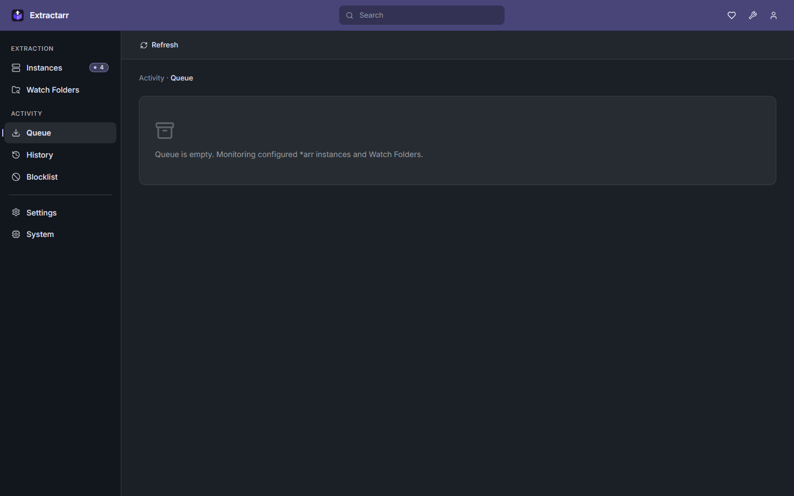
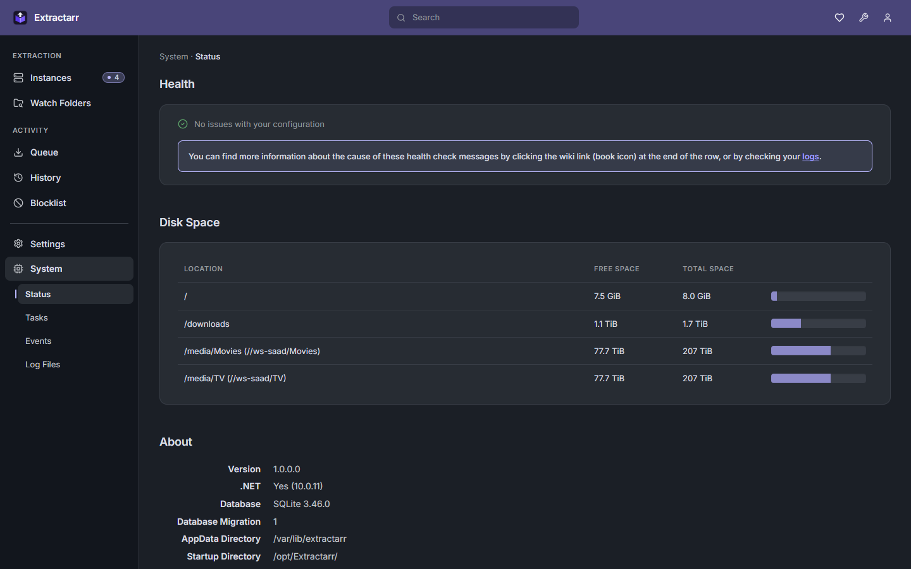
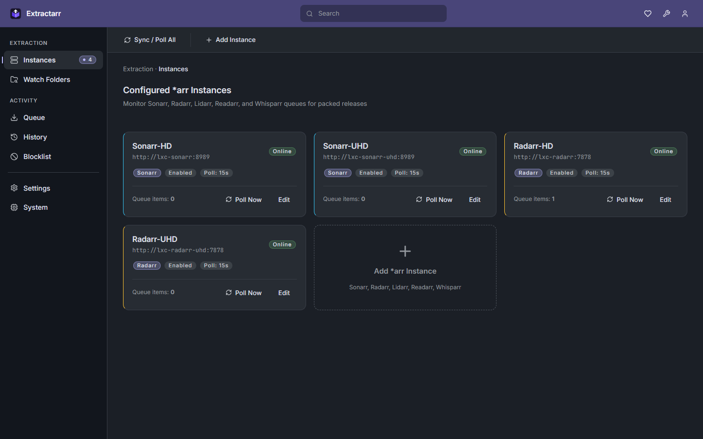

<div align="center">
  

  # Extractarr

  **A Sonarr v5-Styled GUI & Automated Archive Extraction Engine for the `*arr` Ecosystem**

  [](https://github.com/philipsaad/extractarr/releases)
  [](https://dotnet.microsoft.com/)
  [](https://react.dev/)
  [](https://www.sqlite.org/)
  [](#installation--deployment)
</div>

---

## Overview

**Extractarr** pairs the official **Sonarr v5 UI/UX design language** with an automated, seeding-safe archive extraction engine for the entire Servarr suite (**Sonarr**, **Radarr**, **Lidarr**, **Readarr**, and **Whisparr**).

It monitors completed download queues in real time, extracts compressed releases (`.rar`, multi-part `.part01-.partNN.rar`, `.r00-.r99`, `.zip`, `.7z`, `.tar.gz`, `.xz`, etc.), triggers instant `*arr` import scans, and cleans up extracted video payloads after import—**preserving original archives so torrent seeding continues uninterrupted**.

---

## Screenshots

### Extraction Queue (Live Progress & Seeding Protection)


### System Health & Mount Points Status


### Instances Dashboard


---

## Key Features

- **Sonarr v5 UI Experience**: Built with official `oklch` theme tokens, solid violet-indigo headers, left-aligned toolbars, persistently expanded Activity items (`Queue`, `History`, `Blocklist`), and collapsible Settings/System panes.
- **Seeding-Safe Lifecycle**: Unpacks archives to a temporary staging folder (`_unpackerred`), notifies `*arr` via `RefreshMonitoredDownloads`, and deletes only the unpacked duplicates after a configurable delay once import succeeds. Original RARs stay intact for torrent seeding.
- **Cross-Platform Path Translation**: Zero-configuration automatic translation between Windows paths (`C:\Downloads`, `\\server\share`) and Linux mount paths (`/downloads`, `/media/share`).
- **Standalone Watch Folders**: Monitor local folders with real-time `FileSystemWatcher` and polling fallback independent of `*arr` instances.
- **Notifications**: Built-in alerting to Discord, Slack, Telegram, Webhook, Apprise, and Pushover on start, completion, cleanup, or failure.
- **Background Daemon / Service Ready**: Native integration with Linux `systemd` and Windows Service managers.

---

## Installation & Deployment

Extractarr releases are built and attached directly to [GitHub Releases](https://github.com/philipsaad/extractarr/releases) (no external registry required):

### 1. Docker / Docker Compose

Download `extractarr-docker-image.tar.gz` from the latest release:

```bash
docker load < extractarr-docker-image.tar.gz
```

```yaml
services:
  extractarr:
    image: extractarr:latest
    container_name: extractarr
    restart: unless-stopped
    environment:
      - PUID=1000
      - PGID=1000
      - UMASK=002
      - TZ=UTC
      - EXTRACTARR_PORT=8686
    volumes:
      - ./config:/config
      - /path/to/downloads:/downloads
      - /path/to/media:/media
    ports:
      - "8686:8686"
```

### 2. Debian / Ubuntu (.deb)

```bash
sudo dpkg -i extractarr_<version>_amd64.deb
sudo systemctl status extractarr
```

### 3. RHEL / Fedora / CentOS (.rpm)

```bash
sudo rpm -i extractarr-<version>-1.x86_64.rpm
sudo systemctl status extractarr
```

### 4. Linux x64 Standalone Tarball (Proxmox LXC / Custom)

Extract `extractarr-linux-x64.tar.gz` to `/opt/Extractarr`:

```bash
sudo tar -xzf extractarr-linux-x64.tar.gz -C /opt/Extractarr
sudo cp /opt/Extractarr/extractarr.service /etc/systemd/system/
sudo systemctl enable --now extractarr
```

### 5. Windows x64 (Executable or Windows Service)

Unzip `extractarr-windows-x64.zip`:
- **Run directly**: Double-click `start-extractarr.bat`
- **Install as Windows Service**: Right-click PowerShell -> *Run as Administrator*:
  ```powershell
  .\install-windows-service.ps1
  ```

---

## Accessing Extractarr

Once started, navigate to:
- **Web UI**: `http://<ip-or-localhost>:8686`
- **API Swagger v3 Docs**: `http://<ip-or-localhost>:8686/swagger`
- **SignalR Realtime Messages**: `http://<ip-or-localhost>:8686/signalr/messages`
